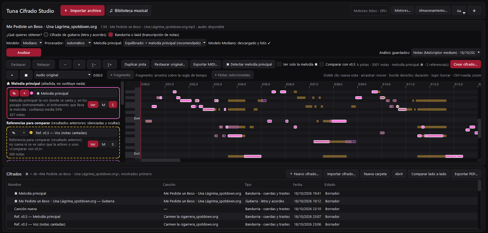

# TunaScriptor

# Readme en distintos idiomas
[](https://github.com/Spectra823/TunaScriptor/blob/main/README.md)
[](https://github.com/Spectra823/TunaScriptor/blob/main/README.es.md)
[](https://github.com/Spectra823/TunaScriptor/blob/main/README.fr.md)

**Du MP3 au *cifrado*, éditeur de *cifrados* et bien plus encore. Un outil spécialement conçu pour les *tunas*.**

Bonjour, je suis Cáscara ! Novice au sein de la Tuna Femenina de Salamanca. Ce projet n'est en aucun cas lié à ma tuna (si quelque chose tourne mal, elle n'en est absolument pas responsable), mais c'est cette expérience qui m'a poussée à créer ce programme. 
TunaScriptor (nom provisoire ; le nom définitif reste à déterminer, mais ce sera probablement Aladín) est un logiciel Windows spécialement conçu pour les tunas. 
Il permet d'importer des chansons afin de générer une analyse et un cifrado approximatif pour la bandurria, le luth et la guitare. 
Il permet également de créer des cifrados de zéro à l'aide de la notation numérique traditionnelle des tunas, puis de les modifier facilement afin de les partager au format PDF ou dans des fichiers éditables.

> 🚧 Le développement est toujours en cours. Le programme n'est donc pas encore disponible au téléchargement et ne le sera pas tant que ses fonctionnalités de base n'auront pas été corrigées et suffisamment peaufinées.
> Consultez la section [Desarrollo actual](#desarrollo-actual) pour en savoir plus.

<p align="center">
  
</p>

## Sommaire
- [Motivations du développement](#motivations-du-développement)
- [Développement actuel](#développement-actuel)
- [Fonctionnement](#fonctionnement)
- [Fonctionnalités actuelles](#fonctionnalités-actuelles)
- [Architecture du programme](#architecture-du-programme)
- [Licence](#licence)

## Motivations du développement
Comme aucune formation musicale formelle n'est requise pour participer à une tuna, nous sommes nombreux à rencontrer des difficultés lorsqu'il s'agit d'interpréter des cifrados traditionnels 
ou de créer nos propres cifrados à partir de zéro pour des chansons qui nous plaisent. Même si apprendre à retrouver une chanson à l'oreille est une compétence essentielle pour tout membre 
d'une tuna, et que cela devient très amusant une fois qu'on en a pris l'habitude, cet exercice est particulièrement difficile au début, surtout pour ceux d'entre nous qui n'ont pas de formation musicale préalable.

C'est pourquoi, afin d'aider mes camarades et de simplifier un peu ce processus, notamment pour les débutants qui font leurs premiers pas dans le monde des tunas et qui ne s'y connaissent pas 
encore beaucoup, j'ai décidé de créer ce programme. Au départ, il devait s'agir d'un petit script Python destiné à m'aider à transcrire des chansons lorsque je débutais. 
Cependant, compte tenu des progrès réalisés ces dernières années dans les outils d'analyse musicale, j'ai pensé qu'il serait judicieux d'élargir les objectifs et de créer quelque chose de plus complexe et d'utile.

Je tiens à souligner une nouvelle fois que cet outil n'a pas pour vocation de remplacer l'apprentissage des chansons à l'oreille. Je pense que nous devrions tous chercher à acquérir et à perfectionner 
cette compétence autant que possible. Toutefois, le programme peut constituer une aide précieuse pour les débutants, ainsi qu'une solution pratique lorsque nous disposons de peu de temps pour préparer un cifrado.
En outre, TunaScriptor peut être utilisé comme un simple éditeur de cifrados par ceux qui préfèrent les écrire de zéro, mais qui souhaitent disposer d'un logiciel plus pratique que les alternatives actuelles, permettant 
notamment d'utiliser nos systèmes de notation numérique pour la bandurria et le luth.

## Développement actuel
 **Tout est encore susceptible de changer.** L'architecture de base, les algorithmes d'analyse, les formats de fichiers utilisés et l'interface sont toujours en cours de développement. 
 Je préfère donc ne pas proposer de téléchargement tant que je ne serai pas satisfaite d'une version du programme.
- **Les résultats varient d'une chanson à l'autre.** Pour le moment, les meilleurs résultats sont obtenus avec les chansons a cappella ou accompagnées d'un seul instrument.
- Lorsque de nombreux instruments se superposent ou que des harmonies sont présentes, la qualité des analyses peut diminuer. L'objectif est d'améliorer le programme
- autant que possible afin de pouvoir analyser de manière convaincante tous les types d'enregistrements.
- **Les principaux axes de développement.** Je travaille surtout à améliorer l'analyse des chansons, en mettant l'accent sur la clarté et le suivi de la mélodie principale
- pour la bandurria et le luth, ainsi que sur le suivi correct des accords et leurs changements pour la guitare.
- **Le programme n'est pas encore prêt pour le grand public.** Il fonctionne sur mon ordinateur, mais je ne l'ai pas encore préparé pour qu'il puisse être utilisé sur d'autres machines.
- Je ne publierai pas d'installateur tant que je ne serai pas satisfaite du programme. Si vous souhaitez malgré tout essayer la version dont je dispose actuellement, vous pouvez me contacter.
- **Une installation simplifiée.** Je m'efforce de simplifier autant que possible l'installation et le téléchargement des différents outils nécessaires à TunaScriptor, afin que
- chacun puisse utiliser le programme sans difficulté, sans devoir configurer soi-même des environnements avec des versions spécifiques ni saisir des commandes dans un terminal.
- Certains obstacles sont toutefois incontournables, notamment les exigences légales liées aux différentes licences des outils d'analyse et des échantillons sonores utilisés pour la guitare.
- Je cherche néanmoins à raccourcir et à simplifier toutes ces étapes autant que possible, notamment en intégrant au programme des guides clairs expliquant chaque étape de l'installation.

## Fonctionnement
Au début, vous devrez suivre le guide d'installation. Celui-ci vous indiquera quels outils sont en cours de téléchargement et vous permettra de choisir ceux que vous souhaitez installer. 
Vous devrez également accepter certaines conditions de licence des modèles. Pour des raisons juridiques, ces étapes ne peuvent pas être davantage automatisées ou simplifiées.
  
Il existe plusieurs façons de commencer un cifrado dans TunaScriptor : vous pouvez importer un fichier MP3 à analyser, en créer un de zéro à l'aide d'un modèle, ou 
effectuer un enregistrement avec votre microphone afin d'obtenir une approximation. Tous les fichiers importés sont enregistrés dans la « Bibliothèque musicale ». 
Vous y retrouverez toutes vos chansons, accompagnées de leur pochette si elles en possèdent une, ainsi que des informations supplémentaires : 
nombre d'analyses et de cifrados associés à chaque chanson, durée et date d'importation.

Une liste de tous les cifrados existants apparaît également en dessous, avec des informations telles que leur type, leur date de création, etc. 
Lorsque vous ouvrez une chanson, les cifrados qui lui sont associés apparaissent en tête de cette liste. 

Une fois la chanson souhaitée importée, l'interface d'analyse s'ouvre. 
Vous pouvez alors choisir le type d'analyse à effectuer : guitare ou bandurria/luth, ainsi que les modèles à utiliser. Plusieurs modèles sont disponibles. 
Certains, plus volumineux et plus précis, nécessitent des ordinateurs puissants et sont plus lents. D'autres, plus légers, sont destinés aux ordinateurs qui ne peuvent pas faire fonctionner les modèles les plus exigeants.

Une barre de progression vous indique l'avancement de l'analyse. Si vous avez choisi le cifrado de guitare, vous pourrez directement consulter le résultat. 
Si vous avez choisi le luth ou la bandurria, vous pourrez examiner l'analyse effectuée, les pistes correspondant aux différents instruments de la chanson, les notes détectées, etc.
Pour créer le cifrado, cliquez sur le bouton « Créer un cifrado ». Dans cette interface, vous pourrez choisir la piste sur laquelle il sera basé. 
Il est recommandé de sélectionner celle qui suit la mélodie principale : la voix du chanteur, s'il y en a une, ou l'instrument dominant pendant les passages purement instrumentaux. 
C'est la piste que j'ai le plus testée pour la création de cifrados, mais vous pouvez choisir celle que vous préférez et modifier chaque piste à votre guise avant de créer le cifrado.
  
Une fois créé, le cifrado recherche les parties répétées afin d'obtenir un résultat aussi compact et lisible que possible. Il reste néanmoins modifiable : vous pouvez ajouter, supprimer ou modifier des notes, ajouter 
ou supprimer des sections, et même changer la tonalité de certaines sections ou de la chanson entière si vous le souhaitez. Cette fonctionnalité a été conçue pour simplifier la création de cifrados correspondant aux 
différentes voix d'une même chanson. Vous pouvez également ajouter les paroles à chaque section du cifrado ; dans les cifrados de guitare, elles sont ajoutées automatiquement.
Avant l'exportation, vous pouvez écouter le cifrado afin de vérifier si le résultat vous convient. La lecture utilise des échantillons d'instruments réels (voir THIRD_PARTY_NOTICES.md).
Enfin, les cifrados peuvent être exportés au format PDF ou dans des fichiers éditables : un format propre à TunaScriptor et le format .musicxml, utilisé par d'autres logiciels tels que MuseScore ou Guitar Pro.

## Fonctionnalités actuelles

Légende : ✅ fonctionne et a fait l'objet de tests automatisés · 🧪 fonctionne, mais les résultats ne sont pas entièrement fiables ou n'a pas encore été testé avec du matériel réel · 🔧 en cours de développement

### Analyse

| Fonctionnalité | État | Remarques |
|---|---|---|
| Transcription des notes d'un enregistrement, avec une piste par instrument | ✅ 🧪 | Utilise le modèle MuScriptor ; la qualité dépend de l'enregistrement et de la taille du modèle |
| Mélodie principale (★) : une seule ligne pour toute la chanson, correspondant à la voix lorsqu'une personne chante et à l'instrument principal dans les autres passages | 🔧 | Les passages chantés sont suivis avec une assez bonne fiabilité. Dans les passages instrumentaux, certaines notes parasites apparaissent encore et d'autres peuvent manquer |
| Mélodie vocale avec séparation facultative de la voix | ✅ 🧪 | Le vibrato est conservé comme une seule note ; les syllabes répétées restent des notes distinctes |
| Reconnaissance des accords (Chordify) et des paroles (Whisper) | ✅ 🧪 | La précision des accords est en cours de validation à partir de sources indépendantes ; la reconnaissance des paroles dépend du modèle |
| Comparaison des accords révisés par TunaScriptor avec les accords originaux de Chordify | ✅ | Script de développement ; les divergences sont évaluées en les confrontant aux notes et à l'audio |
| Détection des sections répétées (couplet, refrain, variations, BIS) | 🔧 | Fonctionne pour de nombreuses chansons, mais certaines sont encore divisées en trop nombreux fragments |

### Cifrados et édition

| Fonctionnalité | État | Remarques |
|---|---|---|
| Cifrados de bandurria et de luth à partir de n'importe quelle partie transcrite | ✅ | Règles de notation propres aux tunas (trémolo, espacement, répétitions et toujours six lignes), doigtés de style tuna et notation du luth identique à celle de la bandurria |
| Cifrados de guitare : paroles avec accords placés sur les syllabes | ✅ 🧪 | Noms d'accords en espagnol (LAm, MI7…) ; le placement respecte le minutage des mots et des accords |
| Création d'un cifrado en chantant dans le microphone (guitare, bandurria et luth) | 🧪 | Fonctionnalité récemment ajoutée ; testée avec des enregistrements synthétiques, mais pas encore avec un microphone réel |
| Transposition (par demi-tons, vers une tonalité ou une tessiture vocale) avec aperçu sonore | ✅ | Les cordes et les cases sont recalculées ; les notes hors tessiture sont signalées et ne sont jamais déplacées silencieusement |
| Édition des notes dans un piano roll, éditeurs de cifrados, annulation et rétablissement | ✅ | Les notes et les paroles incertaines sont mises en évidence pour être vérifiées |
| Voix, solistes, couleurs et légende dans les cifrados de guitare | ✅ | |

### Lecture, sauvegarde et exportation

| Fonctionnalité | État | Remarques |
|---|---|---|
| Lecture de l'enregistrement, des notes ou d'un extrait sélectionné, avec mise en évidence de la partition pendant la lecture | ✅ 🧪 | Les aperçus utilisent des sons synthétisés simples |
| Accompagnement de guitare généré à partir d'un cifrado de guitare, avec possibilité d'ajouter la voix séparée | 🔧 | La synchronisation est garantie par conception ; le rendu sonore reste basique |
| Bibliothèque musicale, analyses sauvegardées, cifrados indépendants, dossiers, sauvegarde automatique et récupération après un plantage | ✅ | Les analyses originales ne sont jamais écrasées ; les résultats précédents de la mélodie sont conservés |
| Exportation au format PDF (avec image de l'écusson et nom de l'auteur) | ✅ | |
| Importation et exportation dans des formats éditables : format natif, tablature MusicXML, ChordPro et MIDI | ✅ | MusicXML n'a pas encore été vérifié dans MuseScore |

## Architecture du programme

Le programme est divisé en deux types de processus afin que les modèles d'analyse musicale ne bloquent pas et ne ralentissent pas l'édition des cifrados.

```text
┌──────────── Application (PySide6 / Qt) ─────────────┐
│ ui/        fenêtres, piano roll, éditeurs de cifrados│
│ cifrado/   modèles de cifrados, doigtés, accords,   │
│            répétitions et structure, transposition  │
│ music/     notes, pistes, résultats des mélodies, MIDI│
│ playback/  lecteur audio, synthèse, enregistrement   │
│ library/   bibliothèque SQLite, sauvegarde, fichiers │
│ export/    échanges PDF, MusicXML / ChordPro         │
│ engines/   lance et supervise les processus d'analyse│
└──────────────┬───────────────────────────────────────┘
               │ Requête JSON sur stdin → lignes JSON sur stdout
┌──────────────▼──────── Processus d'analyse (environnement Python séparé) ──┐
│ muscriptor_worker.py  transcription des notes (MuScriptor, PyTorch)        │
│ chordify_worker.py    accords + paroles (Chordify, Whisper)                 │
│ melody_worker.py      mélodie principale / vocale (librosa ; séparation    │
│                       facultative de la voix avec Mel-Band RoFormer)       │
└────────────────────────────────────────────────────────────────────────────┘
```

- **Transcription** (bandurria et luth) : MuScriptor transcrit l'enregistrement en distinguant les différents instruments présents et en créant une piste pour chacun d'eux.
Il recherche ensuite la mélodie principale — celle qui suit la voix et les instruments les plus importants lorsqu'il n'y a pas de voix — et la sépare du reste dans une autre piste.
Chaque piste peut être convertie en cifrado. Les pistes peuvent être facilement modifiées, combinées, etc. Lors de la création du cifrado, la précision et le confort de jeu sont privilégiés. Par exemple, lorsqu'une note à la sixième case ou au-delà est détectée sur une corde grave, le programme privilégie, lorsque c'est possible, la note correspondante sur la corde suivante.
- **Guitare** : Chordify détecte les accords et Whisper reconnaît les paroles. TunaScriptor recherche ensuite les répétitions et place les accords au bon endroit par rapport aux paroles.
- **Structure** : les parties répétées sont détectées en comparant la mélodie tout au long de la chanson, les instruments et les paroles.
Cela permet, par exemple, d'éviter de répéter sept fois le cifrado du couplet dans Guantanamera lorsqu'il est possible de résumer le tout en un seul couplet avec des paroles différentes.
- **Stockage** : toutes les données sont stockées localement sur l'ordinateur de l'utilisateur, sans nécessiter de connexion à des programmes externes.
Cela permet de préserver la sécurité et la confidentialité de l'utilisateur (et, de plus, aucun budget n'est actuellement disponible pour un serveur). Le programme utilise une base de données SQLite locale.
Les résultats des analyses sont enregistrés sous forme de fichiers JSON immuables, tout comme les cifrados, qui peuvent être modifiés, copiés, partagés, etc.

Pour plus de détails : [docs/ARCHITECTURE.md](docs/ARCHITECTURE.md).

Principaux outils : Python, PySide6 (Qt 6), NumPy, SQLite, ReportLab (PDF), mido (MIDI). Pour l'analyse : PyTorch, MuScriptor, Chordify, Whisper et librosa.

## Licencia
Le code de cette application est publié sous la licence GPL-3.0 [License](LICENSE).

Les modèles et les outils d'analyse sont des logiciels externes soumis à leurs propres licences et conditions ; ils ne sont pas inclus dans le code. 
En particulier, les poids des modèles MuScriptor sont publiés sous la licence CC BY-NC 4.0, avec des conditions d'accès restreintes. Consultez THIRD_PARTY_NOTICES.md.
